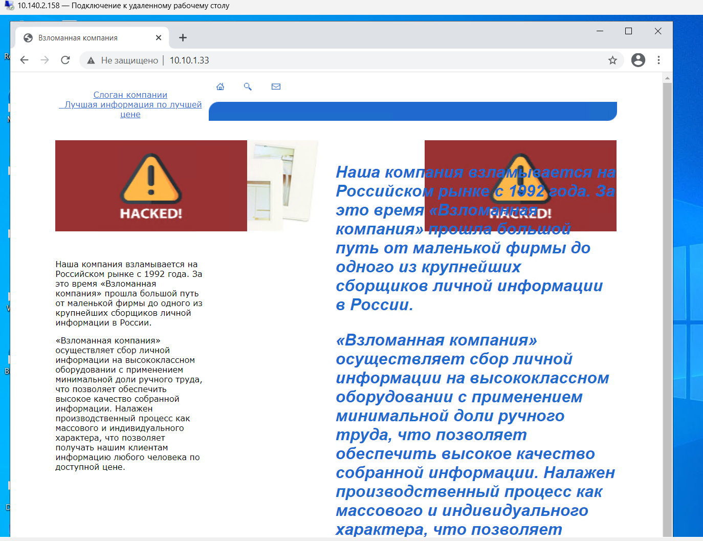
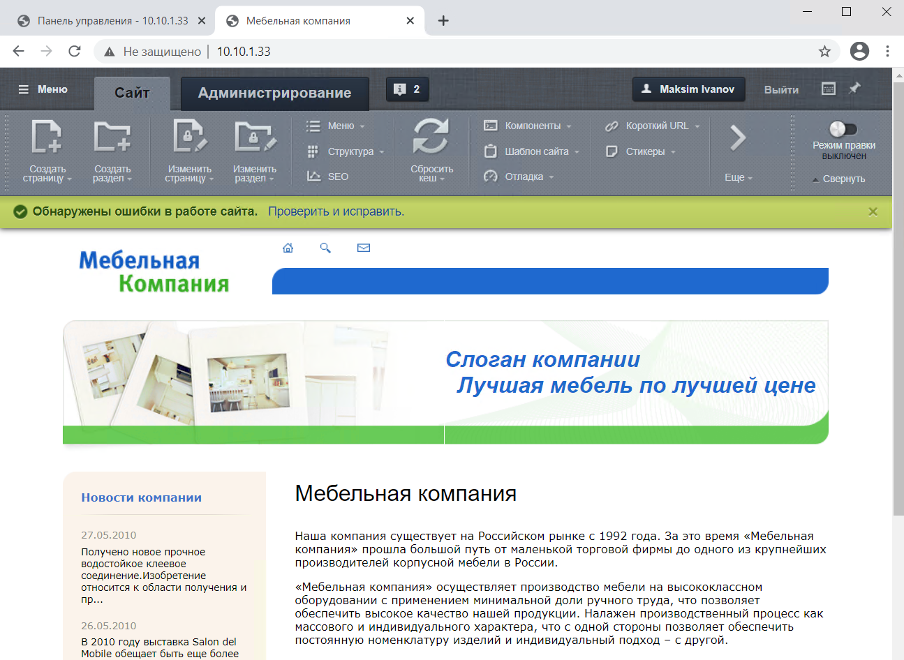
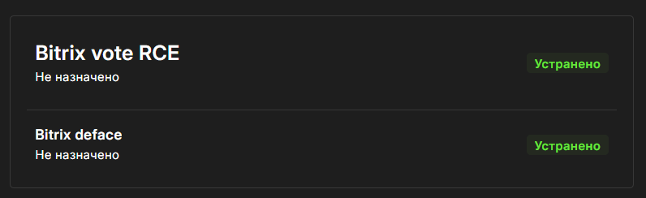
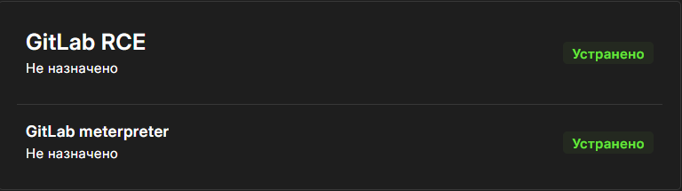
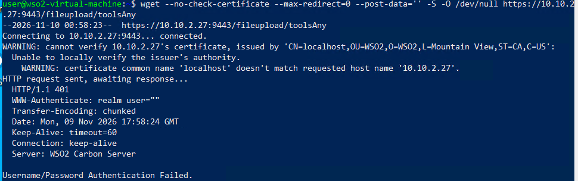
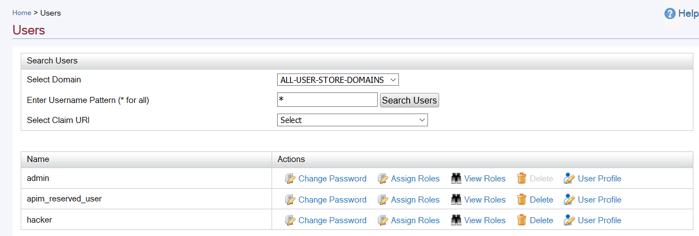
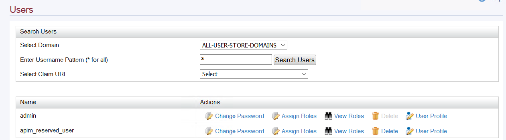

---
## Author
author:
  - name: Назармамадов Умед Джамшедович
    affiliation:
      - ref: rudn
  - name: Талебу Тенке Франк Устон
    affiliation:
      - ref: rudn
  - name: Бахи Сиди Али Темассини
    affiliation:
      - ref: rudn
  - name: Пакавира Арсениу Висенте Луиш
    affiliation:
      - ref: rudn
  - name: Алькамаль Ибрахим Мохсейн Мохаммед Али
    affiliation:
      - ref: rudn
  - name: Баптишта Матеуж Андре
    affiliation:
      - ref: rudn

affiliations:
  - id: rudn
    name: Российский университет дружбы народов
    city: Москва
    country: Российская Федерация

## Title
title: "Лабораторная работа № 3"
subtitle: "Защита интеграционной платформы"
date: "2026-11-09"
date-format: "YYYY-MM-DD"
lang: ru
---

# Информация

## Состав команды

**Группа НФИбд-02-23**

| Участник | Номер или роль |
|---|---|
| Назармамадов Умед Джамшедович | Докладчик |
| Талебу Тенке Франк Устон | 1032224534 |
| Бахи Сиди Али Темассини | 1032234211 |
| Пакавира Арсениу Висенте Луиш | 1032225105 |
| Алькамаль Ибрахим Мохсейн Мохаммед Али | 1032225432 |
| Баптишта Матеуж Андре | 1032225099 |

::: {.notes}
Здравствуйте. Мы выполнили лабораторную работу на учебном полигоне Ampire. Я расскажу, какие следы оставила атака на трёх серверах и как мы проверили результаты устранения.
:::

## Цель и схема работы

Мы исследовали атаки на три узла интеграционной платформы и устранили их последствия.

| Узел | Адрес | Последствие |
|---|---|---|
| Bitrix | `10.10.1.33` | Подмена главной страницы |
| GitLab | `10.10.2.18` | Обратное соединение Meterpreter |
| WSO2 API Manager | `10.10.2.27` | Посторонняя учётная запись |

Для расследования мы сопоставили события **ViPNet IDS NS**, журналы приложений и активные соединения на серверах.

::: {.notes}
ViPNet показал подозрительный трафик. По журналам мы уточнили, какие запросы получил каждый сервер. Через SSH проверили, какие файлы и процессы остались после атаки.
:::

# Ход работы

## Bitrix до и после восстановления

:::::::::::::: {.columns align=center}

::: {.column width="48%"}

**До восстановления**

{width=100%}

:::

::: {.column width="48%"}

**После восстановления**

{width=100%}

:::

::::::::::::::

::: {.notes}
На Bitrix атакующий использовал уязвимость CVE-2022-27228 в модуле vote. В журнале Apache мы нашли запросы к модулю и к файлу caidao.php, который использовался как веб-бэкдор. После восстановления из резервной копии вернулась исходная главная страница.
:::

## Bitrix. Проверка устранения

- Закрыли соединения с `195.239.174.11`.
- Ограничили доступ к модулю `vote`. Контрольный запрос вернул **HTTP 403**.
- Сняли биты SUID и SGID с файла `apache_restart`.

{width=75%}

::: {.notes}
После восстановления мы отдельно проверили уязвимый маршрут и права файлов. HTTP 403 подтвердил запрет доступа к маршруту vote. На полигоне оба пункта по Bitrix получили статус «Устранено».
:::

## GitLab. Завершение сессии Meterpreter

- ViPNet обнаружил попытку эксплуатации **CVE-2021-22205**.
- Завершили процесс, который держал соединение с `195.239.174.11:5558`, и удалили `/tmp/FULFFq`.
- Включили одобрение новых регистраций и удалили учётку `Script Kiddie`.

{width=75%}

::: {.notes}
В сетевом пакете был виден запрос к GitLab с узла Bitrix. На GitLab мы связали обратное соединение с процессом, запущенным из временного каталога. Полигон засчитал настройку регистрации и удаление учётки. Версия GitLab осталась 13.10.2. В ветке 13.10 исправление самой CVE вышло в версии 13.10.3.

<https://about.gitlab.com/blog/action-needed-in-response-to-cve2021-22205/>
:::

## WSO2. Защита маршрута загрузки

- В журнале нашли запрос к `/fileupload/toolsAny` и обращения к `exploit.jsp`.
- Завершили процесс `payload.elf` и удалили оба вредоносных файла.
- Ограничили доступ к `/fileupload` в `deployment.toml`. Запрос без авторизации получил **HTTP 401**.

{width=86%}

::: {.notes}
На WSO2 использовалась уязвимость CVE-2022-29464. ViPNet зафиксировал передачу ELF-файла, а на сервере мы обнаружили процесс payload.elf с активным соединением к адресу атакующего. После изменения конфигурации мы перезапустили службу и проверили запрос без авторизации.

<https://security.docs.wso2.com/en/latest/security-announcements/security-advisories/2022/WSO2-2021-1738/>
:::

## WSO2. Удаление посторонней учётной записи

:::::::::::::: {.columns align=center}

::: {.column width="48%"}

**До удаления**

{width=100%}

:::

::: {.column width="48%"}

**После удаления**

{width=100%}

:::

::::::::::::::

В панели Carbon удалили учётную запись **`hacker`** и повторно проверили список пользователей.

::: {.notes}
Журнал WSO2 показал запросы к форме создания пользователя. В панели Carbon мы нашли учётку hacker, удалили её и убедились, что в списке остались admin и apim_reserved_user.
:::

# Результаты

## Итог проверки на полигоне

| Узел | Что проверили | Статус Ampire |
|---|---|---|
| Bitrix | Главная восстановлена, маршрут `vote` возвращает `403` | Оба пункта устранены |
| GitLab | Обратное соединение закрыто, `Script Kiddie` удалена | Оба пункта устранены |
| WSO2 | Маршрут загрузки возвращает `401`, `hacker` удалён | Оба пункта устранены |

**Оформили три карточки инцидентов. Все шесть пунктов Ampire получили статус «Устранено».**

::: {.notes}
Для каждого узла мы проверили конкретный результат. На Bitrix открылась исходная главная страница, на GitLab исчезло обратное соединение, а на WSO2 запрос без авторизации был отклонён. Все три инцидента зарегистрированы в Ampire. Спасибо за внимание.
:::